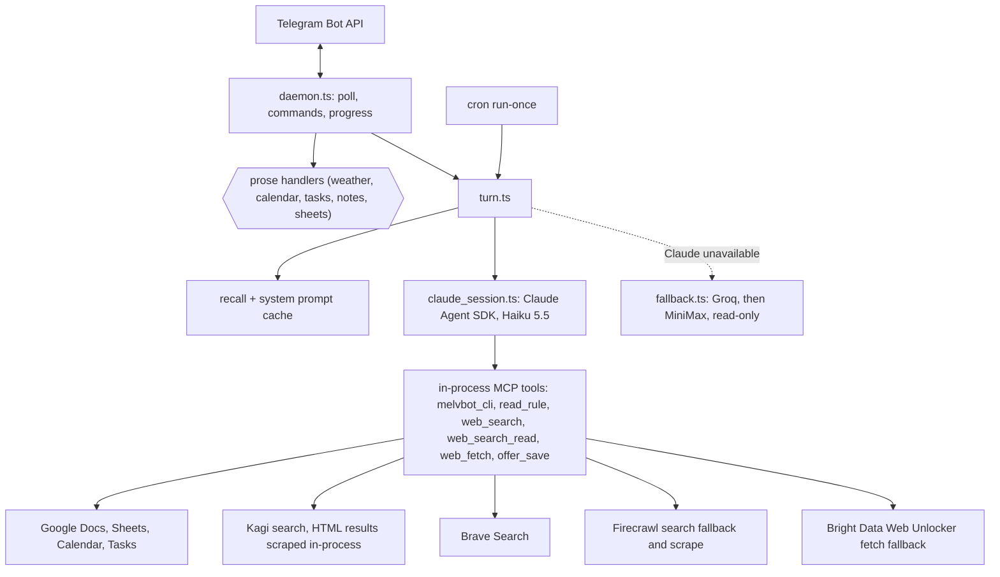

# Architecture

Product code is TypeScript under `ts/src`. The container runs `node /opt/melvbot-ts/dist/index.js` (`melvbot-ts:latest`).

## One chat turn

1. The poller receives a message. Comma commands and whole-message phrasings (weather, calendar, tasks, note and sheet lists) are answered directly, with no model.
2. Otherwise `turn.ts` runs three things in parallel: an optional web-search prefetch, note recall (best FTS match from the cached index), and the system prompt (cached, refreshed in the background).
3. `claude_session.ts` runs one Claude Agent SDK `query()`. A chat's session is continued with `resume`; its transcript lives under `~/.claude` on the runtime volume.
4. The agent has no built-in tools. It can only call the `melvbot` MCP tools. Confirmation gating and the untrusted-content write guard run inside those tools.
5. If Claude is unavailable (limit, login, overload), the turn degrades to a read-only answer from Groq or MiniMax, with a notice. Cron turns fail loudly instead.

## Prose intercepts vs LLM turns

An intercept (`src/telegram/prose_intercept.ts`) answers a whole message with no model; everything else is a Claude turn. The table is ordered, anchored to the whole message, and falls through to Claude when a handler returns false.

- **Add an intercept** only for a frequent, repeatable, low-risk phrasing with a fixed reply (a lookup or a structured write). Open-ended research, summaries and free-form note edits stay on Claude. Never build an intent per phrasing: widen an existing matcher before adding a new entry.
- **Irreversible actions** (deletes, overwrites) keep the confirmation gate, intercept or not.
- **Measure before changing.** Every hit logs `intercept:<name>` in `turn_log`; Claude turns log the prompt. Compare per-route hits with Claude prompts that start with show/list/add/delete/update (`ddb conversation`) to find misses, and read at least a month of rows before removing an intercept (zero hits in two weeks is thin, and smoke tests pollute the log).
- **Fix a miss** by widening the matcher with a regression test for the exact missed phrase, and add the phrase to `test/intercept_overlap.test.ts` if another matcher could also accept it.
- **Remove** an intercept only after 30 days of zero hits; delete its matcher and tests together.
- **Cost:** an intercept saves a full turn (system prompt, recall, tool calls). Prompt-cache hit rate is unaffected because the system prompt stays byte-stable; per-turn data goes in the user message.

## Reminders

Google stores, Telegram alerts. Calendar and Tasks hold the data; melvbot-created events carry a private `melvbot=reminder|event` tag and no Google popup. A background ticker (`src/reminders/ticker.ts`, started by the poll loop) fetches tagged events every 5 minutes and checks the cache every minute: a reminder pings at its start with Done / Snooze buttons (`rm:` callbacks patch the event in Google), an appointment pings 30 minutes ahead. Sent alerts are deduped in `nudges.sqlite3`. At 19:15 SGT it lists tasks still due or overdue with Done / Tomorrow buttons (`tk:`), gated by `[nudges] task_evening`. One formatter (`src/reminders/format.ts`) renders the Morning Update data, agenda replies, alerts and the `reminders` listing.

## Memory layers

| Layer | Where | Lifetime |
|-------|-------|----------|
| Working | Claude session transcript | Until 15 minutes after your last message, or `idle_reset_hours` |
| Episodic | Snapshot saved when a session ends | Injected into the first turn of the next session |
| Semantic | Google Docs notes, indexed in SQLite FTS | Permanent; best match injected per turn |
| Structured | Google Sheets (spend, EV, rules) | Permanent |

## Module map

Live TypeScript tree under `ts/src`. `index.ts` dispatches the CLI (`doctor`, `sheet`, `note`, `google`, `outlook`, `cron`, `memory`, `web`) or starts the poller.

| Area | Modules | Responsibility |
|------|---------|----------------|
| Entry | `index.ts`, `daemon.ts` | CLI dispatch; Telegram long-poll loop, commands, progress edits |
| Telegram | `telegram/api.ts`, `commands.ts`, `progress_edits.ts`, `outbox.ts`, `prose_intercept.ts`, `weather*.ts`, `shopping_list.ts` | Bot API, command parsing, rate-limited edits, model-free replies |
| Agent | `assistant/claude_session.ts` | One Agent SDK `query()` per turn, resume, idle sweep, unavailable backoff |
| | `assistant/turn.ts` | Turn orchestration, audit log, fallback hand-off |
| | `assistant/custom_tools.ts`, `tools.ts` | MCP tools, CLI allowlist, web search/fetch, confirm and write guards |
| | `assistant/system_prompt.ts`, `recall.ts`, `recall_index.ts` | Prompt build and cache refresh, note recall |
| | `assistant/fallback.ts` | Read-only Groq/MiniMax degraded mode |
| | `assistant/web_content.ts` | HTML to markdown, size cap, TTL caches |
| Notes | `note/*` | Google Docs notes; `read_cache.ts` is a 30 s read cache |
| Sheets | `sheet/*` | Spend, EV, rules |
| Google / Outlook | `google/*`, `outlook/*` | Calendar, Tasks, token handling, mail digest |
| Reminders | `reminders/*`, `nudges/*` | Ticker, formatter, proactive nudges |
| Media | `media/*` | Groq STT, MiniMax vision and images, Google/MiniMax TTS |
| Cron | `cron/*` | Job store, `run-once`, morning update (rendered in code from the Google prefetch, no LLM), DCA jobs (data prefetched in code, one tool-free Claude write-up) |
| Health | `doctor.ts`, `session/turn_lock.ts` | Checks and the turn lock |
